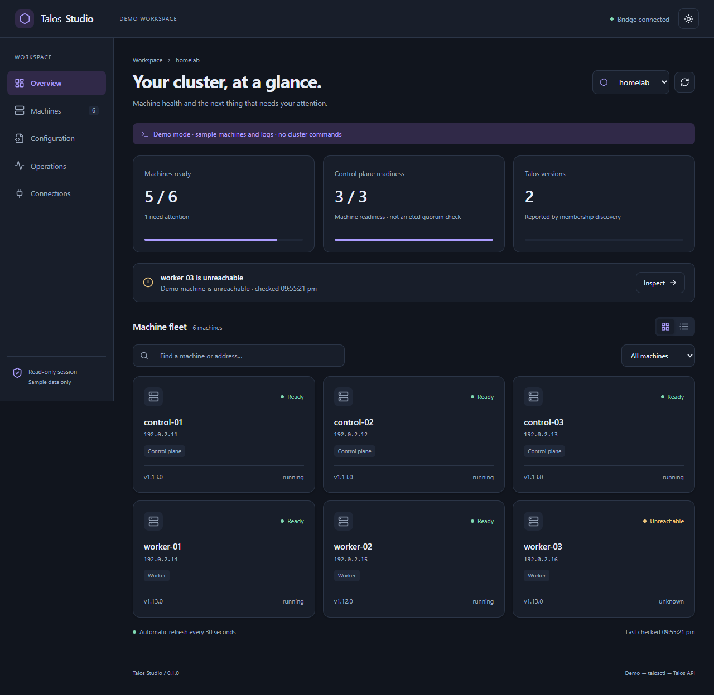

# Talos Studio

A local web interface for Talos Linux. Talos Studio uses the `talosctl` executable installed on your computer and your existing Talos contexts to discover machines, inspect services and hardware, read logs, and review configuration patches and reboots.

It is an independent project, not affiliated with Sidero Labs. It manages existing clusters; provisioning, upgrades, backups, and Omni-style fleet reconciliation are not included in this release.



## Run locally

Requires Node.js 22.12 or later, npm, and an installed `talosctl`. The live integration has been tested with talosctl v1.13.0. Install a client compatible with your cluster using the [Talos documentation](https://www.talos.dev/latest/introduction/getting-started/).

```sh
npm ci
npm run build
npm start
```

Open **http://127.0.0.1:4317**. For development, use `npm run dev` and open **http://127.0.0.1:5173**.

The bridge reads `$TALOSCONFIG`, or `~/.talos/config` by default. Credentials remain in that file; the browser receives context names, endpoints, and node addresses only. Each context needs a numeric node address or endpoint from which cluster membership can be discovered. The bridge tries up to three seed addresses and probes discovered member addresses directly, so those addresses must be reachable from your computer.

To use a binary outside `PATH`, set `TALOSCTL_PATH` to its absolute path. This works on Windows, macOS, and Linux.

```powershell
$env:TALOSCTL_PATH = 'C:\Tools\talosctl.exe'
$env:TALOSCONFIG = 'C:\Users\you\.talos\config'
npm start
```

### Demo mode

Explore the interface without credentials or a Talos installation:

```sh
STUDIO_DEMO=1 npm run dev
```

PowerShell:

```powershell
$env:STUDIO_DEMO = '1'
npm run dev
```

Demo mode uses clearly labeled sample data, disables writes, and provides log snapshots instead of live streams.

## Features

- Context switching with membership discovery and per-machine readiness checks.
- Machine cards and list view, search, role filters, and automatic health refresh.
- Services with separate running, healthy, unhealthy, and unknown states.
- System, processor, memory, and disk resources in the machine inspector.
- Log snapshots and cancellable live streams for services reported by the machine.
- YAML/JSON merge patches with a Talos dry run before applying in `no-reboot` mode.
- Reviewed drain and reboot requests, with a control-plane majority check.
- Session operation history, responsive layout, and light/dark themes.

Membership reports supply Talos versions; they are not fresh remote client-version probes. Machine readiness is not Kubernetes workload health or an etcd quorum check. Failure to discover membership shows an error rather than presenting a partial fleet as healthy.

## Reviewed writes

Writes are disabled by default. Set `STUDIO_WRITES=1` before starting the bridge to enable configuration patches and reboots. Only enable this when you intend to manage the cluster. A dry-run configuration preview remains available in read-only mode.

```powershell
$env:STUDIO_WRITES = '1'
npm start
```

Each review is bound to one context and discovered machine, expires after two minutes, and can be used once. Confirm by typing the machine name. Execution rechecks membership, readiness, and machine identity before issuing a command. Patches use `no-reboot` mode; changes requiring a reboot fail rather than restarting a machine implicitly. Reboot uses `--drain --wait=false`; command success records request acceptance, not recovery. Refresh health to verify recovery.

For multiple control-plane machines, a reboot is blocked unless the remaining machines with healthy running etcd services can form a majority of discovered control-plane members. This is a conservative service-level check, not a full etcd membership/leader verification. A single-control-plane reboot presents an explicit management-outage warning. The actual drain may still fail because of disruption budgets or Kubernetes API availability.

## Local security boundary

The bridge binds exclusively to `127.0.0.1`. It validates the request host, browser origin, Fetch Metadata, and a per-process session token. No CORS access is enabled. CLI arguments are constructed from fixed operations and validated discovered targets, using `spawn` without a shell. There is no arbitrary command endpoint or remote executable-path setting.

Do not expose this service through a network reverse proxy. It is a single-user local tool, not a multi-user server. Other programs running as your local user remain part of the trust boundary. Logs and hardware details may contain sensitive operational data; these are displayed locally and are not sent to a third-party service.

The bridge does not retrieve full machine configurations. Patch text stays in memory for the review lifetime and in a temporary owner-readable file while invoking talosctl; the temporary directory is removed afterward. Common credential fields and PEM blocks are redacted from dry-run/error previews. Redaction is defense in depth, not a guarantee that arbitrary custom fields are non-sensitive. Operation history stores summaries, never patch bodies or logs, and is discarded when the bridge exits.

Read commands have a 15-second timeout and 4 MiB output limit. Dry runs and patch applies have a 30-second timeout. Reboot requests allow 330 seconds for the drain. Log streams are limited to four concurrent streams, 8 MiB output, and ten minutes, and stop when the client disconnects. The browser keeps the latest 250,000 characters. Restart a stream when it reaches a limit. Fleet discovery supports up to 64 members.

## Configuration

| Variable        | Default            | Purpose                   |
| --------------- | ------------------ | ------------------------- |
| `TALOSCTL_PATH` | `talosctl` on PATH | Local executable          |
| `TALOSCONFIG`   | `~/.talos/config`  | Local Talos configuration |
| `STUDIO_PORT`   | `4317`             | Loopback bridge port      |
| `STUDIO_DEMO`   | disabled           | Sample data, no CLI calls |
| `STUDIO_WRITES` | disabled           | Reviewed write operations |

Set variables in your shell; `.env` files are not automatically loaded. Ports must be between 1024 and 65535. The development UI uses port 5173 and proxies API requests to the configured bridge port.

## Development

The frontend uses React and Vite; the local bridge uses Node.js, Fastify, and the installed talosctl. The bridge serves the built UI in production. Shared TypeScript types describe API responses.

```sh
npm run check
```

This runs TypeScript validation, a production build, and tests for resource parsing, configuration validation, request protections, and reviewed-operation safety. Tests use a fake Talos runner and never modify a real cluster.

Browser checks cover context switching, inspection, logs, patch review, themes, and mobile layout:

```sh
npx playwright install chromium
npm run test:e2e
```

The browser test server uses demo mode on port 4318. To use an installed Edge browser instead of downloaded Chromium, set `PLAYWRIGHT_CHANNEL=msedge`.

## License

MIT. See [LICENSE](LICENSE).
